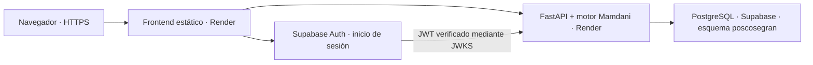

# PLAN-DESPLIEGUE

Fecha de revisión: **2026-09-30**. Objetivo: presentar POSCOSEGRAN mediante una URL HTTPS pública, con frontend, motor difuso, API, autenticación y datos persistentes, sin depender de un servidor en la laptop.

## Opción recomendada

**Render Static Site + Render Web Service gratuito + Supabase Free para PostgreSQL y Auth.**

El repositorio ya incluye React/Vite, una imagen Docker de FastAPI, migraciones PostgreSQL, verificación JWT mediante JWKS y cliente Supabase. Esta combinación aprovecha esos componentes y evita mantener una máquina virtual. La API ejecuta el motor Mamdani y conserva las reglas, explicación, adquisición y seguimiento.



El navegador usa Supabase para autenticarse y FastAPI para el negocio. Las tablas del esquema `poscosegran` permanecen privadas, sin exponerlas mediante la Data API.

## Alternativas y límites reales

| Opción | Componentes | Facilidad | Condición de gratuidad y uso aconsejado |
|---|---|---|---|
| **A. Render + Supabase** | Web estática y API en Render; BD y Auth en Supabase | Alta | Recomendada para el curso; sujeta a cuotas y pausas. |
| **B. Cloudflare Pages + Render + Supabase** | Solo cambia el alojamiento estático | Alta | Pages Free permite 500 compilaciones/mes y 20 000 archivos; suficiente para este frontend. [Límites oficiales](https://developers.cloudflare.com/pages/platform/limits/). |
| **C. Render + Render PostgreSQL + Supabase Auth** | El Blueprint existente `render.yaml` | Alta | Alternativa de demostración breve: PostgreSQL gratuito ofrece 1 GB y expira a los 30 días; no es persistencia gratuita indefinida. [Condiciones oficiales](https://render.com/docs/free). |
| **D. Amazon EC2 + Docker + Supabase** | API en EC2; web estática en Render/Pages; BD y Auth en Supabase | Media | Viable si la cuenta tiene créditos o beneficios aplicables; requiere operación y configuración de HTTPS. [AWS Free Tier](https://aws.amazon.com/free/). |

Render apaga la API gratuita después de 15 minutos sin tráfico y el arranque puede tardar aproximadamente un minuto. Hay 750 horas gratuitas mensuales por workspace y cuotas adicionales de tráfico/compilación. El disco de la API es efímero: los datos deben ir a PostgreSQL. Revisar el consumo del panel antes de la exposición. [Render Free](https://render.com/docs/free).

Supabase Free incluye 500 MB de base de datos, 5 GB de salida y 50 000 usuarios activos mensuales. Un proyecto gratuito con poca actividad puede pausarse tras siete días. Para el curso conviene reactivarlo y comprobarlo el día anterior. [Cuotas](https://supabase.com/docs/guides/platform/billing-on-supabase), [pausas](https://supabase.com/docs/guides/platform/free-project-pausing).

Las cuotas y disponibilidad pueden cambiar. Confirmarlas en las cuentas concretas al desplegar; no activar planes de pago para completar esta demostración.

## Preparación del repositorio

1. Subir a GitHub la versión revisada, incluidos `docs/openapi.json`, `src/api/contrato.ts` y los documentos de esta revisión. Mantener `.env`, contraseñas, tokens y volcados fuera de Git.
2. Ejecutar los controles indicados en [REVISION-SISTEMA-DIFUSO.md](REVISION-SISTEMA-DIFUSO.md) y verificar que el contrato regenerado no diverja después del commit.
3. Usar **Node 22 actualizado**, pnpm 10.24.0 y Python 3.13, o las imágenes Docker del repositorio.
4. Preparar cuentas individuales para productor, técnico, administrador y dos ingenieros de conocimiento. Quien propone una versión no puede activarla.
5. Elegir regiones cercanas entre API y BD cuando la disponibilidad gratuita lo permita.
6. Tener listas la URL definitiva de API y la del frontend antes de fijar CORS y compilar la web.

`render.yaml` crea la opción C, con PostgreSQL de Render y una credencial común para API/migración. **La opción A se configura manualmente en Render**, sin aplicar ese Blueprint sin cambios: no crear la BD de Render y usar las dos conexiones de Supabase explicadas abajo. No es necesario modificar las reglas para cambiar de alojamiento.

## Paso 1: Supabase PostgreSQL y Auth

### Proyecto y conexiones

Crear un proyecto Free. En **Connect**, copiar una conexión PostgreSQL adecuada para el servidor. Para IPv4 usar **Session pooler, puerto 5432**; permite las sentencias preparadas de Psycopg. No usar el pooler de transacciones de puerto 6543 con la configuración actual, porque requiere desactivar prepared statements y revisar estado de sesión. Usar `sslmode=require`, el host real del panel y contraseña codificada en la URL. [Conexiones oficiales](https://supabase.com/docs/guides/database/connecting-to-postgres).

Preparar dos identidades de base de datos:

- **Migraciones:** propietario administrativo, por ejemplo el usuario `postgres` del proyecto.
- **Aplicación:** `poscosegran_app`, con contraseña distinta y únicamente permisos de negocio.

En el SQL Editor, conectado como propietario, crear el usuario de aplicación:

```sql
CREATE ROLE poscosegran_app LOGIN PASSWORD '<contraseña generada>';
GRANT CONNECT ON DATABASE postgres TO poscosegran_app;
```

No copiar íntegro `backend/sql/roles_privilegios.sql` en Supabase: ese archivo está pensado para una base local llamada `poscosegran` y altera permisos de `public`. En Supabase conservar intactos los esquemas y roles gestionados de Auth y Storage. [Gestión de roles](https://supabase.com/docs/guides/database/postgres/roles).

Para el usuario de aplicación, una conexión a Session pooler normalmente usa `poscosegran_app.<PROJECT_REF>`; comprobar la conexión antes de configurar Render. En conexión directa el usuario no lleva ese sufijo. Copiar el host del panel, no deducirlo del nombre de la región.

### Migrar y cargar la semilla

Desde el entorno Python local, usar la conexión administrativa para preparar la BD remota. En este paso todavía no se inicia la API pública:

```powershell
$env:POSCOSEGRAN_ENTORNO = 'produccion'
$env:POSCOSEGRAN_BD_URL_MIGRACIONES = '<URL administrativa con postgresql+psycopg y sslmode=require>'
$env:POSCOSEGRAN_BD_URL_APP = $env:POSCOSEGRAN_BD_URL_MIGRACIONES
$env:POSCOSEGRAN_KNOWLEDGE = (Resolve-Path knowledge).Path
$env:POSCOSEGRAN_JWT_MODO = 'JWKS'
$env:POSCOSEGRAN_JWT_ALGORITMOS = 'ES256,RS256'
$env:POSCOSEGRAN_JWT_EMISOR = 'https://<PROJECT_REF>.supabase.co/auth/v1'
$env:POSCOSEGRAN_JWT_JWKS_URL = 'https://<PROJECT_REF>.supabase.co/auth/v1/.well-known/jwks.json'
$env:POSCOSEGRAN_AUTH_LOCAL_HABILITADA = 'false'
backend/.venv/Scripts/python.exe backend/scripts/render_prepare.py
```

El preparador aplica migraciones y carga la semilla solo si no existe una versión activa. Tras ello ejecutar en el SQL Editor el contenido de **`backend/sql/permisos_aplicacion.sql`** como propietario. Finalmente sustituir `POSCOSEGRAN_BD_URL_APP` por la URL restringida y comprobar una conexión y `SELECT 1`.

Después de cada migración futura revisar/aplicar otra vez los permisos. La API necesita actualizar `motivo` al descartar propuestas, pero no puede reescribir el contenido de versiones existentes.

### Autenticación y roles de aplicación

En Supabase Auth utilizar una clave de firma **asimétrica** ES256 o RS256 disponible en JWKS. Los proyectos con firma antigua HS256 deben migrar esa configuración antes de usar este backend en producción; el secreto compartido local no está permitido.

Crear los usuarios de demostración y confirmar sus correos desde el panel, con contraseñas privadas. Configurar la URL del sitio y redirecciones con la URL HTTPS de la web.

Copiar cada UUID de Auth y aprovisionar el rol de negocio correspondiente mediante:

```powershell
backend/.venv/Scripts/python.exe backend/scripts/administrar.py --usuario '<UUID de Auth>' --nombre 'Productor demo' --rol PRODUCTOR --motivo 'Cuenta para presentación académica'
```

El script usa `POSCOSEGRAN_BD_URL_MIGRACIONES`. Repetir para los demás roles; los dos revisores llevan `INGENIERO_CONOCIMIENTO`. Un usuario autenticado sin registro y rol en `poscosegran` no obtiene acceso. El técnico requiere además asignación a lote/almacén, con `--responsable` de un administrador y motivo. No usar las cuentas locales como mecanismo de acceso público.

## Paso 2: API en Render

Crear un **Web Service** desde el repositorio, plan Free y runtime Docker:

| Campo | Valor |
|---|---|
| Dockerfile | `backend/Dockerfile` |
| Contexto de build | Raíz del repositorio |
| Health check | `/salud/bd` |
| Comando | `sh -c "python scripts/render_prepare.py && uvicorn poscosegran.api.app:crear_app --factory --host 0.0.0.0 --port 10000"` |

La imagen incluye `/knowledge` y su variable de entorno. El preparador corregido migra con la conexión administrativa y conserva una versión de conocimiento ya aprobada.

Configurar estas variables como secretos del servicio cuando corresponda:

| Variable | Valor |
|---|---|
| `POSCOSEGRAN_ENTORNO` | `produccion` |
| `POSCOSEGRAN_BD_URL_APP` | URL restringida de Supabase con `postgresql+psycopg://` y SSL |
| `POSCOSEGRAN_BD_URL_MIGRACIONES` | URL administrativa de Supabase para el preparador |
| `POSCOSEGRAN_JWT_MODO` | `JWKS` |
| `POSCOSEGRAN_JWT_ALGORITMOS` | `ES256,RS256` |
| `POSCOSEGRAN_JWT_AUDIENCIA` | `authenticated` |
| `POSCOSEGRAN_JWT_EMISOR` | `https://<PROJECT_REF>.supabase.co/auth/v1` |
| `POSCOSEGRAN_JWT_JWKS_URL` | `https://<PROJECT_REF>.supabase.co/auth/v1/.well-known/jwks.json` |
| `POSCOSEGRAN_AUTH_LOCAL_HABILITADA` | `false` |
| `POSCOSEGRAN_CORS_ORIGENES` | URL exacta de la web, sin barra final; varias separadas por coma |
| `POSCOSEGRAN_BD_POOL_TAMANO` | `2` |
| `POSCOSEGRAN_BD_POOL_DESBORDE` | `1` |

No fijar CORS a `*`. No habilitar autoactivación de propuestas. Verificar `https://<API>/salud/bd` hasta que responda conectado. La documentación interactiva `/documentacion` está desactivada en producción; esto es el comportamiento previsto.

El plan Free no ofrece shell de servicio: el aprovisionamiento se hace con el script local apuntando a la BD remota y las migraciones con el comando de arranque.

## Paso 3: frontend estático

Crear un Static Site en Render:

- Build: `corepack enable && corepack prepare pnpm@10.24.0 --activate && pnpm install --frozen-lockfile && pnpm build`.
- Directorio publicado: `dist`.
- Node: versión 22 actualizada.
- Reescritura SPA: `/*` → `/index.html`.

Variables de **compilación**, no de sesión:

```dotenv
VITE_AUTH_MODE=supabase
VITE_API_URL=https://<API-real>.onrender.com/api/v1
VITE_SUPABASE_URL=https://<PROJECT_REF>.supabase.co
VITE_SUPABASE_ANON_KEY=<clave pública anon o publishable>
```

Solo la clave pública de Supabase va en Vite. Las contraseñas PostgreSQL, la clave `service_role` y credenciales administrativas nunca van en variables `VITE_*`. Si cambia una URL o clave pública, recompilar la web.

En Cloudflare Pages se usa el mismo build y `dist`. Comprobar que las rutas SPA profundas regresen `index.html` y que CORS incluya el dominio final de Pages.

## Amazon: cuándo y cómo sería viable

AWS permite alojar la API en EC2 con la imagen Docker existente. El frontend puede seguir en Render/Pages y PostgreSQL/Auth en Supabase para reducir la operación.

Para nuevas cuentas elegibles, el Free Plan ofrece USD 100 iniciales y hasta USD 100 adicionales por actividades; dura hasta seis meses o hasta agotar créditos. No supone alojamiento permanente gratis. Una cuenta antigua tiene condiciones distintas: revisar su panel de beneficios. [Planes oficiales de AWS](https://docs.aws.amazon.com/awsaccountbilling/latest/aboutv2/free-tier-plans.html).

### Ruta EC2

1. Verificar el plan, saldo y región; elegir una instancia Linux de arquitectura **x86_64** y tamaño permitido por la cuenta. Estimar instancia, EBS, tráfico e IPv4.
2. Instalar Docker en la VM; clonar la revisión aprobada y construir `backend/Dockerfile` desde la raíz.
3. Migrar/aprovisionar Supabase según el paso 1. Ejecutar el contenedor de API con las variables de producción y `--restart unless-stopped`; publicar su puerto solamente en `127.0.0.1`.
4. Colocar un proxy HTTPS delante de la API y configurar un nombre DNS y certificado válidos. Si no hay dominio propio, validar una opción de DNS gratuito compatible con la obtención de certificado. La web HTTPS no puede llamar una API HTTP.
5. Abrir 80/443 en el grupo de seguridad; SSH solo desde la IP del equipo. Mantener PostgreSQL fuera de los puertos públicos de la VM.
6. Publicar el frontend estático con la URL HTTPS real de EC2 y probar Auth/CORS.
7. Revisar facturación y parar recursos cuando termine su uso.

La IPv4 pública tiene una tarifa base de USD 0,005/hora antes de beneficios o créditos; además existen costos de cómputo y disco. Evitar un NAT Gateway o balanceador solo para esta exposición. [Precio oficial de IPv4](https://aws.amazon.com/vpc/pricing/).

El Compose actual está preparado para desarrollo local con autenticación local y puertos enlazados a loopback. Para EC2 se necesita configuración de producción separada; no basta subirlo y abrir el puerto 8080. API Gateway + Lambda también requeriría un adaptador ASGI y revisar conexiones/preparación de BD, por lo que no es la ruta más sencilla para esta entrega.

## Ensayo y respaldo de la presentación

### El día anterior

- Confirmar que Supabase no esté pausado y que el servicio API esté desplegado.
- Iniciar sesión con cada rol y comprobar sus permisos.
- Registrar un almacén/lote/unidad y evaluar un caso completo favorable, uno de humedad en transición y uno de moho.
- Comprobar en resultado: μ, α, centroide, origen, R30, motivos y fuentes.
- Simular una propuesta como ingeniero y activarla con el revisor distinto.
- Reiniciar/redesplegar la API y comprobar que registros y versión activa persistan.
- Guardar un respaldo del esquema privado antes de cambiar conocimiento:

```powershell
pg_dump --dbname '<URL PostgreSQL administrativa estándar>' --schema poscosegran --format custom --file poscosegran-presentacion.dump
```

Usar la conexión directa si la red soporta IPv6; para este respaldo simple de un esquema, validar Session pooler si solo hay IPv4. El programa `pg_dump` requiere URL `postgresql://`, no `postgresql+psycopg://`, y versión compatible con el servidor. El respaldo no incluye usuarios de Supabase Auth: registrar sus UUID y configuración por separado.

### Antes de exponer

Abrir la web y consultar `/salud/bd` unos minutos antes, esperar la respuesta real y recorrer un caso. Mantener una evaluación de ejemplo previamente guardada. Llevar capturas o una grabación breve como respaldo de conectividad, junto con el informe y la base de reglas.

### Si algo falla

| Síntoma | Comprobación |
|---|---|
| Primera petición lenta | Esperar el arranque de Render y consultar salud. |
| Error de conexión PostgreSQL | Proyecto activo, host/puerto de Session pooler, contraseña codificada, SSL y permisos del rol. |
| 401 | Firma asimétrica, JWKS, emisor y audiencia del mismo proyecto. |
| 403 con sesión válida | UUID aprovisionado, rol de negocio y asignación del técnico. |
| Error CORS | Origen exacto de la web, sin rutas ni barra final, y recompilación con URL de API correcta. |
| Recargar una ruta da 404 | Reescritura SPA a `index.html`. |
| Adquisición rechaza propuesta | Leer las restricciones de transición; conservar rampas ordenadas y usar dos ingenieros distintos para activar. |

## Criterio de terminado

Una URL pública permite iniciar sesión, evaluar con el motor difuso real, consultar explicación, registrar seguimiento y gestionar conocimiento según el rol; los datos sobreviven a un reinicio. El ensayo debe repetirse desde otro equipo o conexión.

Este archivo es un plan verificable. La revisión local no creó cuentas de nube ni publicó el repositorio; faltan las URLs, credenciales y creación de recursos de las cuentas del equipo.

