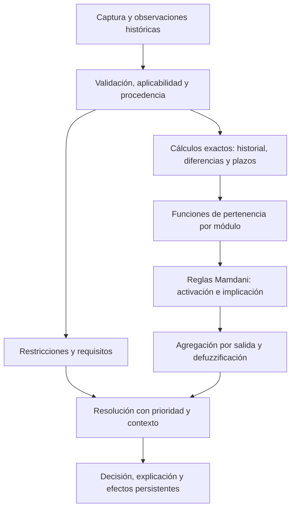

# Plan de refactorización de POSCOSEGRAN a inferencia difusa

Fecha: 18 de octubre de 2026.

Estado: **base 5.0 activa; decisión final mediante Mamdani implementada, migrada y verificada.** La base 4.0 y las anteriores se conservan para reproducir el historial.

## Nueva revisión solicitada: la decisión final debe proceder de Mamdani

Esta revisión sustituye el objetivo arquitectónico de la actualización 4.0: se mantiene el propósito de autorizar almacenamiento de maíz chulpi y la cobertura documental, pero Mamdani debe producir la evaluación final. No basta con que un índice difuso añada solicitudes a una tabla de decisiones exactas.

**Estado real:** motor 3.0.0-mamdani, cuatro mediciones/9 reglas de conservación y once antecedentes/14 reglas de decisión final. La matriz R01–R52, el código, las pruebas y las diferencias frente a versiones anteriores se documentan en [CONVERSION_DIFUSA.md](docs/CONVERSION_DIFUSA.md) y [VERIFICACION_MAMDANI_FINAL.md](docs/VERIFICACION_MAMDANI_FINAL.md). Los apartados siguientes conservan el diseño aprobado y su lista de aceptación; el tiempo futuro refleja la redacción del plan original.

### A. Cambio respecto a la implementación existente

Antes de 5.0, `sistema_difuso/motor.py` calculaba un centroide conjunto y agregaba solicitudes preventivas. Después, `sistema_experto/motor.py` ejecutaba `_resolver`, que seleccionaba la primera rama verdadera de R30. Por tanto, la decisión general combinaba inferencia difusa con resolución exacta.

En la nueva versión, la evaluación de negocio terminará en **activación Mamdani → implicación → agregación → centroide → clasificación de la salida**. La tabla R30 histórica se conservará para reproducir versiones anteriores; no elegirá la decisión de una evaluación nueva. Tampoco se calculará una decisión exacta anterior para convertirla en una entrada 0/1 de una envoltura difusa.

Fuera de la inferencia permanecerán identidad, permisos, formato y unidades, calidad de datos, fechas y cálculos de intervalos, consulta de evidencias vigentes, persistencia e idempotencia. Estos procesos preparan hechos y contexto; no deben emitir por su cuenta una autorización, corrección o cuarentena que sustituya el resultado del nuevo modelo.

### B. Modelo Mamdani propuesto

Se diseñará un modelo jerárquico, con responsabilidades explícitas:

1. **Condiciones graduales de conservación.** Se parte de humedad del grano, temperatura del grano, HR ambiental cuando aplique y granos defectuosos. La matriz de cobertura determinará si temperatura del almacén, tiempo documentado u otra magnitud necesita una entrada adicional o un módulo específico. No se sumarán porcentajes de defectos solapados ni se comprimirá evidencia distinta en un indicador arbitrario.
2. **Condiciones sanitarias y operativas.** Moho, contaminación, plagas, exposición química, integridad del recipiente y otros hallazgos relevantes participarán como antecedentes observables o derivados con procedencia documentada. Cuando la evidencia solo indique presencia/ausencia, sus pertenencias serán 0/1; no se inventará una intensidad intermedia. Los límites documentales que deban ser estrictos se representarán explícitamente dentro del modelo y no se suavizarán sin fundamento.
3. **Inferencia de decisión.** Combinará los grados de conservación, los hallazgos categóricos, el estado de evidencia, la modalidad, la fase, el plazo y el seguimiento aplicable mediante reglas Mamdani. Las salidas distinguirán las siete acciones externas existentes. La clasificación del centroide será una lectura de la salida calculada, no una segunda tabla de restricciones que cambie el resultado después.

Un modelo jerárquico evita enumerar el producto cartesiano de los 94 campos. No implica que todos esos campos se conviertan en entradas simultáneas. La interfaz diferenciará mediciones principales, antecedentes categóricos, datos derivados y registro administrativo.

**Cantidad de entradas y reglas:** cuatro entradas graduales y nueve reglas describen exclusivamente el núcleo 4.0. No se promete conservar esas cantidades para la evaluación completa mediante Mamdani. El número definitivo se publicará tras la matriz de las 52 reglas, la definición de dependencias y las pruebas de cobertura. No se añadirán una o dos variables solo para aparentar mayor complejidad ni se retirará una comprobación relevante para cumplir una cifra estética.

### C. Condiciones críticas sin compensación

Un promedio o un centroide de conclusiones permisivas y críticas puede diluir una condición inaceptable. Por ello no basta con añadir «SI hay moho ENTONCES cuarentena» junto a reglas favorables sin modificar sus antecedentes.

- Las reglas permisivas deberán exigir evidencia de ausencia de las condiciones críticas aplicables.
- La presencia comprobada de una condición crítica activará la conclusión correspondiente y llevará a cero la activación de conclusiones incompatibles mediante los antecedentes del propio modelo.
- Esta exclusión se especificará en el YAML y será visible en la traza. No se implementará como `if moho: decision = CUARENTENA` después de defuzzificar.
- Desconocido no equivale a ausencia, pertenencia favorable ni valor numérico cero. Una conclusión crítica conocida podrá emitirse aun con otros datos faltantes; autorizar exigirá evidencia suficiente.
- Una cuarentena abierta seguirá siendo un hecho persistente de entrada; mediciones favorables no la cerrarán ni la harán desaparecer de los antecedentes. Su cierre técnico conservará permisos y evidencias.
- Los conjuntos de salida, sus soportes, la clasificación de su centroide y las exclusiones se probarán juntos. Se evitará interpolar acciones incompatibles de ingreso/seguimiento o convertir una falta de evidencia en una condición favorable.

### D. Cobertura de las 52 reglas documentales

Se preservan fuentes y alcance; «cubrir» no significa convertir cada regla documental en exactamente una producción difusa. La matriz distinguirá regla difusa, antecedente categórico, cálculo/validación, recomendación y dato administrativo. R30 cambiará de implementación, manteniendo las decisiones y su significado.

| Origen | Papel que debe conservarse en la nueva evaluación |
|---|---|
| R01 | Humedad no apta; consecuencia de ingreso/seguimiento representada dentro del modelo. |
| R02 | Banda de humedad condicional y requisitos de plazo, modalidad, revisión y seguimiento. |
| R03 | Humedad favorable como condición parcial, nunca autorización suficiente por sí sola. |
| R04 | Actividad de agua medida y alerta hídrica/fúngica; antecedente condicional. |
| R05 | Calidad y confirmación de medición; dato inválido no alimenta pertenencias como favorable. |
| R06 | Aptitud ambiental según modalidad e integridad hermética. |
| R07 | Riesgo de rehumedecimiento en no hermético. |
| R08 | Condiciones térmicas del grano y del almacén, sin perder una de las mediciones. |
| R09 | Cambio térmico calculado con lecturas comparables y necesidad de revisión. |
| R10 | Recomendación de aireación favorable; no crear un permiso general por ella. |
| R11 | Aireación desfavorable; condiciona la recomendación correspondiente. |
| R12 | Protección hermética comprobada y aplicabilidad de verificaciones ambientales. |
| R13 | Hermeticidad comprometida y necesidad de corrección. |
| R14 | Infestación confirmada como condición crítica de la inferencia. |
| R15 | Indicios de infestación y necesidad de revisión/corrección. |
| R16 | Condiciones favorables a insectos y seguimiento preventivo. |
| R17 | Sospecha de contaminación biológica como antecedente sanitario. |
| R18 | Deterioro sospechado como antecedente sanitario. |
| R19 | Consecuencia de cuarentena y persistencia; exclusión de conclusiones permisivas. |
| R20 | Contaminación de origen animal; no compensación por mediciones favorables. |
| R21 | Defectos y granos enfermos; conservar referencias y evitar dobles conteos. |
| R22 | Granos quebrados y materias extrañas; necesidad de limpieza/clasificación. |
| R23 | Recipiente no apto y efectos según fase. |
| R24 | Separaciones y disposición de estiba; conservar condiciones relevantes. |
| R25 | Higiene del almacén y evidencia de limpieza. |
| R26 | Calidad del aire y exposición incompatible. |
| R27 | Vigencia de controles; fechas calculadas exactamente y estado usado como antecedente. |
| R28 | Proximidad al límite del tiempo documentado y seguimiento. |
| R29 | Vida/plazo agotado y consecuencias según fase. |
| R30 | Sustituir selección por ramas exactas por la inferencia final Mamdani. |
| R31 | Filtraciones del almacén; necesidad de corrección y renovación de inspección. |
| R32 | Drenaje deficiente y corrección. |
| R33 | Barreras contra ingreso de plagas y corrección. |
| R34 | Higiene del entorno y corrección. |
| R35 | Material residual en el almacén y corrección. |
| R36 | Unidad expuesta a agua como condición crítica y episodio persistente. |
| R37 | Aptitud de paletas; separar propiedad del almacén de montaje de la unidad. |
| R38 | Estiba insegura y necesidad de corrección. |
| R39 | Acceso de inspección y separación aplicable entre estantes. |
| R40 | Identificación verificable de la unidad; evidencia insuficiente no permite autorizar. |
| R41 | Integridad de trazabilidad y necesidad de completar evidencia. |
| R42 | Movimientos no registrados; no reutilizar ubicación o inspección sin comprobar contexto. |
| R43 | Contacto con unidad en cuarentena como antecedente crítico. |
| R44 | Aislamiento de cuarentena, únicamente cuando corresponda. |
| R45 | Derrame de grano y corrección documentada. |
| R46 | Reincorporación no verificada de grano derramado como antecedente crítico. |
| R47 | Recomendación logística de rotación; no convertirla en impedimento sanitario. |
| R48 | Contacto con productos de olor incompatible y corrección. |
| R49 | Programa documentado de control de plagas; evidencia vigente. |
| R50 | Tratamiento no verificable como antecedente crítico. |
| R51 | Contacto químico sospechado como antecedente crítico. |
| R52 | Vencimiento comercial aplicable; fecha exacta alimenta el estado de entrada al modelo. |

Cada fila tendrá un vínculo verificable con entradas, reglas, conjuntos, fuente, traza y casos de prueba. No se afirmará cobertura solo porque el identificador siga apareciendo en el catálogo.

### E. Captura compacta y reutilización segura

Objetivo de interfaz: **cuatro etapas**, sin diez pantallas obligatorias para todos los casos:

1. Identificación y modalidad, recuperadas de los registros existentes.
2. Mediciones principales y confirmación del procedimiento; campos adicionales según el caso.
3. Verificación sanitaria y operativa: preguntas necesarias del lote, evidencia reutilizada y comprobaciones pendientes.
4. Resultado con acciones y explicación técnica desplegable. La revisión previa podrá integrarse antes de enviar sin convertirse en una quinta etapa obligatoria.

La captura será guiada por la aplicabilidad y la evidencia necesaria para el modelo, no por mostrar indiscriminadamente el catálogo completo. El usuario verá qué datos se reutilizan, su fecha, responsable, evidencia y alcance; podrá corregirlos.

La reutilización actual es por unidad (`observaciones.historicas`, filtro `id_unidad`), no una inspección compartida de almacén. Para reutilizar entre lotes se deberá implementar un registro explícito de inspección por almacén, con permisos, versión/revisión, fecha, vigencia, responsable y observaciones. No se copiarán silenciosamente observaciones de otro lote.

Clasificar primero cada campo por alcance. Filtración, drenaje e higiene ambiental pueden corresponder al almacén; defectos del grano, contacto químico, envase, montaje de estiba y hallazgos del lote no se heredarán por compartir almacén. Revisar por separado datos dependientes de ubicación o de una operación concreta.

La duración de vigencia se tomará de las fuentes o se identificará como política del prototipo; no se inventará una duración silenciosa. Eventos que cambien las condiciones, revisiones de almacén, traslados o evidencia vencida invalidarán la reutilización correspondiente. La evaluación guardará los identificadores y la procedencia de la inspección aplicada. Si falta evidencia vigente, pedirá la comprobación sin rellenarla como favorable.

Se conservarán borradores, valores cero, observaciones históricas identificadas, edición directa y navegación móvil. Los pasos históricos 1–10 seguirán interpretándose correctamente; el nuevo flujo necesitará un mapeo explícito de pendientes y enlaces de edición.

### F. Explicación que debe ver el usuario y la profesora

- Datos usados, unidades, calidad, fecha, origen y si fueron aportados o reutilizados.
- Entradas numéricas con dominios, funciones triangulares/trapezoidales, puntos y grados calculados; entradas categóricas con sus pertenencias 0/1 reales.
- Reglas activadas y no aplicables, antecedentes completos, AND/OR usados, intensidad de activación y consecuentes.
- Función recortada de cada consecuente, agregación y centroide del módulo final; mostrar los módulos intermedios si el modelo es jerárquico.
- Conjunto/intervalo de salida que determina la decisión, con clasificación documentada y acciones resultantes.
- Condiciones críticas que hicieron inaplicables las conclusiones permisivas; la explicación debe proceder de las mismas activaciones calculadas, no de un texto preparado aparte.
- Fuentes de las referencias, distinción entre límites documentales y curvas/política del prototipo. El valor no se describirá como probabilidad de inocuidad.
- Versión, hash y reproducción histórica. Las evaluaciones 2.0, 3.1 y 4.0 no se renombrarán ni recalcularán como si procedieran del nuevo motor.

### G. Tareas de implementación y verificación

- [x] Identificar la resolución vigente y documentar por qué 4.0 todavía combina Mamdani con R30 exacto.
- [x] Incorporar en este plan la nueva arquitectura, matriz inicial R01–R52, reglas de no compensación y simplificación de captura.
- [x] Completar el diseño ejecutable de variables, dependencias, conjuntos de salida, clasificación y reglas. Publicar cantidades definitivas de entradas por módulo, reglas difusas y campos administrativos; no reutilizar el conteo 4/9 para describir todo el nuevo modelo.
- [x] Crear una nueva versión de conocimiento y motor, preservando la semilla 4.0. Base 5.0/motor 3.0.0-mamdani validada.
- [x] Implementar la inferencia final sin llamar al selector histórico R30 ni introducir una decisión exacta anterior como entrada del modelo.
- [x] Mantener los límites documentados y condiciones críticas dentro de las reglas del modelo, con exclusión de conclusiones incompatibles verificable en la traza.
- [x] Añadir validaciones de dependencias, cobertura, dominios, clasificación de salidas y ausencia de ciclos en los módulos. Un modelo inválido no se registra ni activa.
- [x] Implementar el alcance y vigencia de inspecciones de almacén, migración aditiva, permisos y reutilización con procedencia. Mantener datos propios del lote y episodios persistentes separados.
- [x] Sustituir las diez pantallas por el flujo compacto; preservar captura parcial, NO_APLICA justificado, borradores y enlaces históricos de edición.
- [x] Actualizar API, contrato TypeScript, adquisición/simulación y panel de explicación para el módulo final de decisión.
- [x] Probar matemáticas y límites de cada conjunto; cobertura por modalidad/fase, valores intermedios, ausencia de evidencia y zona sin reglas.
- [x] Probar condiciones críticas individualmente frente a entradas favorables; exigir activación cero de permisos incompatibles y resultado no permisivo. Incluir hallazgos simultáneos y cuarentena persistente.
- [x] Probar que cambios graduales admisibles alteran activaciones, envolvente y salida final; demostrar casos donde Mamdani modifica justificadamente seguimiento/corrección.
- [x] Comparar los 242 casos históricos y conservar sus expectativas; verificar que la matriz R01–R52 cubre todos los identificadores, con escenarios completos y críticos focalizados. Documentar diferencias y nuevas autorizaciones.
- [x] Probar aislamiento de almacenes/lotes, inspección vencida, traslado, evento invalidante, falta de permisos y prevalencia de observaciones actuales; impedir fugas de datos y herencia de hallazgos de otro lote.
- [x] Ejecutar suite Python/PostgreSQL, pruebas E2E de los cuatro pasos, edición y resultado, accesibilidad básica, responsive, análisis estático y construcción Docker.
- [x] Actualizar documentación, informe de verificación y matriz final de cobertura; activar la nueva versión sin borrar historial ni volúmenes.

### H. Criterios de cierre y consecuencias

La revisión estará terminada cuando una evaluación nueva pueda rastrearse desde sus observaciones hasta la decisión mediante activaciones Mamdani, agregación, centroide y clasificación, sin una segunda decisión R30 o un reemplazo posterior en código. Debe conservar las condiciones críticas, abstenerse ante evidencia insuficiente y demostrar el efecto de los grados intermedios sobre decisiones de casos completos.

No se afirmará que todo el software es difuso: fechas, permisos, persistencia y validación siguen siendo exactos. Sí deberá poder afirmarse que **la evaluación final de negocio procede de Mamdani**. Con los mismos datos y configuración el resultado seguirá siendo reproducible y determinista; «difuso» describe grados de pertenencia, no aleatoriedad.

Consecuencias: nueva versión de conocimiento y motor; posiblemente más entradas/reglas internas que 4/9; cambios justificados cerca de transiciones; clasificación y explicación nuevas; registro compartido de inspecciones con migración aditiva; menos preguntas repetidas por lote. La compacidad de la interfaz no se conseguirá perdiendo cobertura. Las curvas y políticas requerirán validación agronómica: pruebas técnicas correctas no equivalen a validación de campo.

---

## Actualización 4.0 implementada — antecedente de la revisión vigente

Esta actualización sustituye el diseño de veinte módulos independientes descrito en las secciones históricas de este plan. El usuario aprobó simplificarlo y conservar las restricciones documentadas. No se evalúa despacho, venta ni consumo.

- [x] Conservar la base 3.1 y su reproducción histórica; publicar la nueva semilla como base 4.0, motor 2.0.0-mamdani.
- [x] Usar un único núcleo con cuatro variables: humedad del grano, temperatura del grano, humedad relativa del almacén y granos defectuosos. En hermético, excluir la HR ambiental: quedan tres entradas aplicables, sin inventar una lectura favorable.
- [x] Implementar nueve reglas lingüísticas: dos de condiciones bajas según modalidad; dos de severidad media; dos de severidad alta; tres de interacción entre humedad/temperatura/HR medias. AND mínimo, OR máximo, implicación mínimo, agregación máximo y centroide exacto.
- [x] Conservar referencias de R02/R07/R08/R21; identificar las curvas, interacciones y cortes 35/65 como política del prototipo, pendiente de validación agronómica. No sumar porcentajes de defectos ni usar un promedio que compense una restricción crítica.
- [x] Validar sintaxis, referencias, dominios, cobertura de reglas en ambas modalidades y tratamiento explícito de entradas ausentes. Bloquear autorización cuando falte una entrada aplicable; no convertir desconocido en cero.
- [x] Mantener las 52 reglas documentales y las comprobaciones exactas útiles. El catálogo conserva 94 campos para no perder trazabilidad: no se afirmará que solo cuatro valores bastan para una autorización completa.
- [x] Mostrar cuatro entradas principales en captura, con comprobaciones del método y mediciones complementarias separadas. Ocultar campos condicionales únicamente cuando el contexto permita excluirlos; conservar borradores y acceso a edición.
- [x] Mostrar la salida conjunta, las cuatro pertenencias, los nueve antecedentes, sus activaciones y el efecto real sobre la decisión. Distinguir las reglas difusas de las documentales.
- [x] Ejecutar pruebas matemáticas, cobertura cartesiana lingüística y malla numérica, modalidades, datos ausentes, prioridades, regresión histórica, API con PostgreSQL, compilación y navegación de interfaz.
- [x] Actualizar documentación y comparación de decisiones; reconstruir y comprobar Docker en localhost:8080 sin borrar datos.

Consecuencias: algunas recomendaciones preventivas cambian al retirar módulos independientes; las restricciones exactas y los episodios persistentes permanecen. Los resultados anteriores son inmutables. Nueve reglas dispersas cubren 81 combinaciones lingüísticas en no hermético y 27 en hermético; esas combinaciones no son otras tantas decisiones externas. El formulario inicial se simplifica, pero una autorización sigue exigiendo evidencia sanitaria y documental.

## Plan original de primera conversión — registro histórico

Las secciones numeradas siguientes conservan la planificación inicial. Sus propuestas de módulos, entradas y salidas internas fueron sustituidas por la actualización 4.0 anterior; no son tareas pendientes ni la arquitectura vigente.

Este plan es independiente de `PLAN_TEMPORAL_DIAGNOSTICO_Y_MEJORAS.md`. El primer documento conserva el diagnóstico y los cambios de calidad, edición, limpieza y corrección de integración. Este segundo documento define la conversión académica del razonamiento a un sistema experto difuso, sus consecuencias y su validación.

## 1. Objetivo y límites de la conversión

Convertir el caso existente a un **sistema experto difuso Mamdani de tipo 1, modular y con varias salidas internas**, conservando la cobertura del conocimiento original y el alcance de evaluación de condiciones de almacenamiento.

No se sustituirá el caso por una evaluación reducida a tres mediciones ni se añadirá un índice decorativo que el motor ignore. El resultado difuso deberá intervenir efectivamente en las recomendaciones, en la clasificación de las condiciones y en las decisiones que admita la política del dominio.

Se conservarán las siete decisiones externas actuales:

1. `CUARENTENA`: separar y solicitar evaluación técnica.
2. `BLOQUEAR_INGRESO`: ingreso no autorizado.
3. `RETIRAR_LOTE`: suspender almacenamiento en las condiciones actuales.
4. `CORREGIR_Y_REEVALUAR`: corregir y volver a evaluar.
5. `SIN_CONCLUSION_AUTOMATICA`: faltan datos o revisión.
6. `AUTORIZAR_CON_MONITOREO`: autorización con seguimiento reforzado.
7. `AUTORIZAR_ALMACENAMIENTO`: autorización con controles ordinarios.

Se mantendrán acciones, motivos, fuentes, datos pendientes, controles, vigencia y trazabilidad. No se añadirá una autorización de consumo, inocuidad o venta: eso sería una ampliación funcional del caso original.

**Equivalencia exigida:** mismo propósito, cobertura de las 52 reglas documentales y conservación de las restricciones críticas. No se promete identidad de todas las decisiones junto a los límites: introducir gradualidad puede producir diferencias que deberán quedar justificadas, versionadas y probadas.

## 2. Línea base comprobada

| Elemento | Situación actual |
|---|---|
| Modelo | Producciones deterministas; lógica VERDADERO/FALSO/DESCONOCIDO y NO_APLICA contextual. |
| Conocimiento | 52 identificadores R01–R52; 62 producciones ejecutables; nueve ramas R30. |
| Entradas del catálogo | 94: 62 booleanas, 21 numéricas, 6 categóricas/textuales y 5 fechas. |
| Parámetros | 29; base declarada 2.0, parámetros 1.0, motor 0.8.0. |
| Regresión | 242 casos congelados; no equivalen a observaciones de campo ni a etiquetas para entrenar un modelo. |
| Problemas previos | Incidencias nuevas sin persistencia, requisitos/riesgo/aplicabilidad incompletos, captura de 28 campos nuevos ausente en evaluación, método truncado al escribir, Mypy y contrato desactualizados. |

Los problemas previos se corrigen o se cubren por pruebas antes de usar el sistema actual como referencia. El hecho de que una versión antigua devuelva una autorización no la convierte en una expectativa correcta si reproduce uno de los defectos ya comprobados.

## 3. Arquitectura recomendada

### 3.1 Tres responsabilidades distintas

1. **Validación y contexto:** calidad/vigencia de datos, aplicabilidad, modalidad, fase, identidad y restricciones categóricas.
2. **Inferencia Mamdani:** evaluación gradual de magnitudes y condiciones justificadas, mediante módulos pequeños y reglas dispersas que utilicen las entradas pertinentes.
3. **Resolución de decisión y efectos:** combinar conclusiones, restricciones, requisitos y fase; emitir una decisión y persistir sus incidencias/acciones.

El producto resultante será un **sistema experto difuso con restricciones explícitas**. No se afirmará que todas sus operaciones son difusas: fechas, identidad y estados persistentes mantienen semántica exacta.

Se comienza con módulos independientes y resolución común. Solo se incorporarán salidas de un módulo como entradas de otro cuando la matriz de dependencias lo justifique. Así se evita introducir una jerarquía innecesaria o perder información por resumir prematuramente todo en un índice.

### 3.2 Flujo



### 3.3 Núcleo propuesto para la profesora

```text
backend/src/poscosegran/
  sistema_difuso/
    modelo.py          tipos y contrato de una base difusa
    pertenencia.py     funciones triangulares y trapezoidales
    validacion.py      dominios, cobertura, referencias y dependencias
    motor.py           fuzzificación, activación, implicación y agregación
    defuzzificacion.py centroide y tratamiento de área nula
    explicacion.py     pertenencias, reglas y contribuciones al resultado
  sistema_experto/      implementación histórica compatible con sus versiones
  dominio/motor.py      fachada: selecciona implementación por tipo/versión
  servicios/           observaciones, vigencia, incidencias y persistencia

knowledge/
  modelo_difuso.yaml    variables, conjuntos, reglas y política de resolución
  catalogo_difuso.yaml  fuentes, justificaciones y vínculo con R01–R52
```

Estos son destinos propuestos, no archivos ya creados. El motor histórico se conserva para reproducir evaluaciones emitidas; no se ejecutarán dos motores activos para decidir una misma evaluación. No se duplicarán reglas en React.

## 4. Entradas: qué se mantiene y qué se transforma

### 4.1 Inventario y semántica

Se conservan inicialmente los 94 campos de captura/contexto y sus metadatos de observación. El número de campos del formulario no es el número de antecedentes simultáneos de una regla ni el número de variables continuas del sistema difuso.

| Clase | Tratamiento |
|---|---|
| Numéricas | Candidatas a pertenencias cuando representan una condición gradual; algunas sirven exclusivamente para validar medición o construir una variable derivada. |
| Booleanas | Presencia/ausencia comprobada. Pueden actuar como guardas 0/1, sin inventar intensidad intermedia. |
| Categorías/texto | Selección de método, modalidad o comparabilidad; no convertir códigos de texto a números ordinales arbitrarios. |
| Fechas | Cálculos exactos de antigüedad, vigencia y tiempo; no fuzzificar el año o el identificador de una fecha. |
| Desconocidas/inválidas | Ausencia de evidencia utilizable; nunca pertenencia favorable 0,5 ni una medición cero. |
| NO_APLICA | Excluye exclusivamente las comprobaciones permitidas por el contexto y con su motivo. |

No se pedirá al usuario que introduzca una pertenencia, un peso o un «porcentaje de seguridad». El servidor los calcula a partir de observaciones y del modelo versionado.

### 4.2 Variables graduales propuestas

| Familia | Variables observadas/derivadas | Etiquetas iniciales de trabajo | Referencias de la base actual |
|---|---|---|---|
| Humedad | `humedad_grano` | base / condicional / elevada | 13 y 14 % b.h. |
| Temperatura | Temperatura de grano aplicable y del almacén | favorable / próxima a alerta / elevada | Alerta de 25 °C. |
| Ambiente | HR del almacén cuando corresponda | favorable / próxima al límite / elevada | Referencia de 60 % en no hermético. |
| Agua disponible | `actividad_agua` si se midió válidamente | baja / próxima a alerta / elevada | Referencia 0,70. |
| Evolución térmica | Diferencia entre lecturas válidas comparables | estable / creciente / significativa | Referencia de 2 °C; ventana temporal separada. |
| Calidad física | Porcentajes de suciedad, defectos, enfermedad, roturas y materias extrañas | conforme / próxima al límite / excedida | Límites por variable; no un promedio de porcentajes distintos. |
| Estiba | Distancias a piso, pared, techo y entre estantes | insuficiente / próxima al mínimo / suficiente | 0,15; 0,50; 1,00 m y criterio específico entre estantes. |
| Conservación | Fracción de vida consumida calculada | disponible / próxima al agotamiento / agotada | 0,80 y 1,00 del modelo actual. |
| Controles | Relación entre tiempo transcurrido y plazo aplicable | vigente / próximo al límite / vencido | Plazo dependiente de modalidad y riesgo; sin circularidad. |
| Aireación | Margen humedad grano–equilibrio, diferencia térmica y HR exterior | favorable / marginal / desfavorable | Equilibrio identificado y filtro exterior actual. |

Los nombres son propuesta de modelado. Los puntos de referencia provienen de la base existente, que mezcla valores publicados, transferidos y políticas del prototipo. **No se presentan las curvas ni todas esas referencias como límites científicos validados específicamente para chulpi.**

La temperatura de la muestra pertenece primero a la validez del procedimiento. La temperatura máxima ambiental usada en una estimación hermética no se presentará como medición interna real. Ambos casos deben conservar procedencia y reglas de uso.

## 5. Funciones de pertenencia y operadores

### 5.1 Especificación de cada variable

Antes de programar el motor se producirá una ficha versionada por variable con:

- nombre, unidad y dominio operativo;
- origen observado o cálculo derivado, con su fórmula;
- condiciones de validez y aplicabilidad;
- conjuntos lingüísticos y puntos de sus funciones;
- referencia/localizador que respalda el criterio;
- fundamento del ancho de transición y solapamiento;
- comportamiento fuera del dominio y en extremos;
- reglas consumidoras y casos de frontera esperados.

Las funciones iniciales serán triangulares y trapezoidales para facilitar revisión y explicación. La elección se documentará por variable. Los anchos de transición serán parámetros del modelo que requieren revisión, no constantes escondidas en Python.

No se fijan aquí curvas numéricas supuestamente publicadas: las fuentes extraídas respaldan criterios y puntos de referencia, pero no proporcionan un modelo difuso completo. Definir y revisar esas curvas es un entregable previo obligatorio de la fase 2.

### 5.2 Configuración inicial de Mamdani

- Tipo 1.
- AND: mínimo.
- OR: máximo.
- Implicación: recorte por mínimo.
- Agregación de consecuentes: máximo por salida.
- Defuzzificación: centroide.
- Pesos de reglas inicialmente iguales a 1; cualquier excepción exige fundamento y versión.
- Activación α en [0,1], registrada sin confundirla con una probabilidad.

Para una salida agregada μ(y): `centroide = integral(y * μ(y)) / integral(μ(y))`.

La implementación tendrá un contrato numérico explícito: integración por segmentos lineales cuando sea aplicable y tolerancias documentadas. Las curvas muestreadas de la interfaz serán visualizaciones, no la autoridad del cálculo. Área agregada cero significa salida no disponible, nunca resultado favorable por defecto. Los datos fuera de dominio se reportarán; no se recortarán silenciosamente para obtener pertenencias.

### 5.3 Límites del significado

Una pertenencia de 0,7 a «humedad elevada» no es una probabilidad del 70 % de contaminación. Un índice interno 0–100 tampoco es porcentaje de inocuidad. La interfaz y la documentación mostrarán expresamente esas diferencias.

## 6. Conversión de reglas y cobertura completa

### 6.1 Correspondencia de las 52 reglas originales

| Familia | Identificadores de origen | Conversión prevista |
|---|---|---|
| Humedad y medición | R01–R05 | Pertenencias de humedad y actividad de agua; validación del método separada. |
| Ambiente y aireación | R06–R11, R16 | Inferencia gradual de temperatura/HR/márgenes; guardas por modalidad y lluvia; recomendaciones específicas. |
| Hermeticidad y recipiente | R12–R13, R23 | Contexto y comprobaciones de integridad; combinar con condición difusa de humedad sin inventar hermeticidad parcial. |
| Plagas, deterioro y contaminación | R14–R15, R17–R20, R36, R43, R46, R50–R51 | Conservar hechos adversos observados y episodios; magnitudes cuantitativas admiten pertenencias sin debilitar las restricciones de cuarentena. |
| Calidad física | R21–R22 | Conjuntos por indicador y reglas de corrección, con cada causa identificada. |
| Almacén, estiba e higiene | R24–R26, R31–R35, R37–R39, R45, R48–R49 | Distancias graduales; condiciones categóricas verificadas; no compensar filtración con otro elemento favorable. |
| Tiempo y controles | R27–R29, R52 | Vida/control graduales donde corresponda; vencimiento comercial aplicable y restricciones temporales conservados. |
| Identidad y trazabilidad | R40–R42, R44 | Requisitos y restricciones de identidad/historial; cuarentena persistente e aislamiento. |
| Logística | R47 | Aviso de rotación; no se incorpora artificialmente al índice sanitario o de almacenamiento. |
| Decisión | R30 | Resolución de resultados difusos con prioridades, fase, requisitos y restricciones explícitas. |

La tabla cubre R01–R52 una vez cada una. Cada regla nueva tendrá identificador propio y `origen: [Rxx]`. Una regla original podrá corresponder a varias producciones nuevas, y una regla nueva podrá citar más de un antecedente documental cuando se justifique.

**No se promete exactamente 52 reglas difusas.** Se exigirá cobertura del 100 % de los 52 requisitos documentales. El inventario final distinguirá reglas documentales, producciones Mamdani, validaciones/restricciones y reglas de resolución.

### 6.2 Ejemplos de traducción a revisar

| Origen | Ejemplo de formulación |
|---|---|
| R01 | SI humedad es elevada ENTONCES necesidad de suspensión es alta. |
| R02 | SI humedad es condicional ENTONCES necesidad de seguimiento es alta, sujeta a modalidad, clima, plazo, dictamen y plan. |
| R03 | SI humedad es base ENTONCES condición de humedad es favorable; esto por sí solo no autoriza. |
| R07 | SI modalidad es no hermética Y HR es elevada ENTONCES necesidad de corrección por rehumedecimiento es alta. |
| R08 | SI temperatura del grano O del almacén es elevada ENTONCES necesidad de corrección térmica es alta. |
| R21 | SI defectos son excedidos O granos enfermos son excedidos ENTONCES necesidad de corrección de calidad es alta. |
| R24 | SI separación al piso O pared O techo es insuficiente ENTONCES necesidad de corrección de estiba es alta. |
| R28 | SI vida consumida está próxima al agotamiento ENTONCES necesidad de seguimiento es alta. |
| R18/R19 | SI moho visible está comprobado ENTONCES solicitar cuarentena; una buena condición de humedad no cancela esa solicitud. |

Estas son plantillas de diseño, no una base ejecutable completa. Se requieren también reglas de condición favorable y de zonas intermedias para cubrir el dominio aplicable. No se asumirá normalidad simplemente porque no se activó una regla adversa.

### 6.3 Sin explosión combinatoria innecesaria

Las reglas consultarán subconjuntos pertinentes. No se generará un producto cartesiano de los 94 campos. La validación deberá detectar regiones sin cobertura, contradicciones, reglas inalcanzables y salidas no disponibles. Se dividirán módulos si la cobertura o las interacciones lo requieren; reducir el número de reglas nunca justificará omitir una comprobación del caso.

## 7. Salidas y decisión final

### 7.1 Canales internos

Se propone separar condición favorable y necesidades de seguimiento, corrección y suspensión. La cuarentena tendrá causas explícitas y prioridad obligatoria; no se inferirá ausencia de contaminación de un índice ambiental favorable.

Si se utilizan salidas internas normalizadas a 0–100, sus rangos, conjuntos y reglas serán parte del modelo aprobado. Antes de implementar la resolución se fijará una tabla que indique cómo cada salida influye en las siete decisiones, incluyendo empates y resultados contradictorios. No se elegirán cortes como «70 significa apto» sin una justificación del modelo.

Las reglas categóricas pueden activar restricciones con grado 1. No se suavizará una cuarentena abierta, un vencimiento aplicable o una identidad no verificable para conseguir un modelo aparentemente más difuso.

### 7.2 Prioridad y garantías

- Cuarentena comprobada o episodio abierto conserva su prioridad.
- Suspensión conserva distinción entre ingreso y seguimiento.
- Correcciones conocidas no desaparecen porque otro módulo sea favorable.
- Datos necesarios ausentes impiden autorizar, aunque otros módulos puedan calcularse.
- La banda condicional conserva sus requisitos de contexto, dictamen y monitoreo mientras esa política siga aprobada.
- Solo se autoriza tras satisfacer los requisitos de la rama correspondiente.
- El sistema puede emitir una decisión adversa con información parcial si hay evidencia suficiente; no debe exigir completar todo el formulario para advertir moho.
- Se emite una sola decisión, conservando todos los motivos y acciones compatibles.

La salida difusa deberá tener influencia demostrable en casos válidos y no bloqueados. Una implementación que calcule curvas pero decida siempre exclusivamente con el motor antiguo no cumple este plan.

## 8. Fuentes y justificación académica

Cada ficha y regla distinguirá:

1. **Referencia publicada:** valor o relación localizado en la fuente.
2. **Transferencia:** criterio para maíz general/amarillo duro u otro contexto aplicado provisionalmente al chulpi.
3. **Diseño difuso:** forma de función, solapamiento, universo y elección de operadores.
4. **Política del prototipo:** prioridades, bandas excepcionales, plazos y tabla de decisión.

Se revisarán las fuentes S01–S09 de `knowledge/catalogo.yaml`, sus localizadores y su correspondencia real con cada parámetro. Las inconsistencias de atribución se resolverán antes de presentar valores como publicados. No se atribuirán a SENASA, FAO o Codex funciones triangulares que no hayan publicado.

Referencias metodológicas para el diseño:

- [Mamdani y Sugeno: mecanismo y diferencias](https://www.mathworks.com/help/fuzzy/types-of-fuzzy-inference-systems.html).
- [Definición de funciones de pertenencia](https://www.mathworks.com/help/fuzzy/define-membership-functions-using-fuzzy-logic-designer.html).
- [Organización de sistemas difusos jerárquicos](https://www.mathworks.com/help/fuzzy/fuzzy-trees.html).

Estas referencias sustentan el método de inferencia, no los umbrales agronómicos. La revisión técnica del software no sustituye la validación del modelo para uso de campo.

## 9. Persistencia, contratos e historial

La conversión no se realizará sobrescribiendo el contenido de la versión 2.0 existente.

- Registrar una nueva versión de conocimiento y motor, con tipo de inferencia, hash del contenido, funciones y política de resolución.
- Mantener un despacho de implementación por tipo/versión. Las versiones antiguas sin discriminador explícito se interpretarán como el motor histórico mediante una regla de compatibilidad documentada.
- No recalcular ni reetiquetar evaluaciones antiguas como difusas. Una nueva evaluación del mismo lote constituye otro registro.
- Guardar datos efectivos, conjuntos utilizados, activaciones, contribuciones a salidas, resultados numéricos, política aplicada y versión numérica del cálculo necesarios para reproducir la explicación.
- Diseñar una migración aditiva y permisos compatibles con la inmutabilidad. Una tabla de detalle difuso por evaluación es la opción inicial; se validará su costo frente a conservar toda la traza en una instantánea JSONB inmutable.
- Añadir información difusa al contrato sin retirar los campos de decisión, motivos y vigencia que ya consume React.
- Devolver tolerancias explícitas al comparar resultados numéricos reproducidos; coincidencia de decisión y versión obligatoria.
- La activación del modelo nuevo respetará revisión, impacto, cuatro ojos y una sola versión activa.

El rollback operativo consiste en reactivar una versión compatible para evaluaciones futuras. No revierte la historia ni levanta incidencias creadas durante el uso del modelo nuevo. No se ejecutará una migración destructiva para volver atrás.

## 10. Interfaz y explicación

Se reaprovecharán las mejoras de captura del primer plan. Se añadirá:

- resumen con la decisión y qué hacer, conservando prioridad sobre los detalles matemáticos;
- identificación de evaluación histórica/difusa y versión utilizada;
- panel de explicación con entradas, pertenencias, reglas activadas, intensidad y contribución;
- curvas legibles de entrada/salida, accesibles y con equivalente textual/tabular;
- separación entre salida difusa y restricción que determinó la decisión;
- unidades y procedencia de datos observados, históricos y estimados;
- comparación pedagógica de casos cercanos al límite, sin permitir alterar una evaluación emitida;
- exportación de una explicación de ejemplo para la exposición, sin credenciales ni datos personales innecesarios.

El módulo Adquisición deberá validar funciones de pertenencia, reglas y cambios de política, medir su impacto y conservar sus versiones. No se limitará a permitir cambiar umbrales del lenguaje determinista antiguo.

## 11. Relación con el primer plan

| Trabajo previo | Relación con esta conversión |
|---|---|
| Persistencia de incidencias y causas nuevas | Precondición; se reutiliza la corrección, no se duplica. |
| Requisitos y NO_APLICA | Precondición de entradas válidas y de decisiones explicables. |
| Captura de todos los grupos y continuidad de borradores | Compartido; se implementa una vez. |
| Mypy, contrato y limpieza de código | Compartido; los contratos se regeneran de nuevo al añadir el resultado difuso. |
| Corrección de riesgo del motor actual | Base de comparación; no seguir extendiendo el motor histórico con funciones difusas. |
| Documentación de algoritmo | El primer plan explica la base histórica; este añade diseño y explicación del motor nuevo. |
| Ocultar documentación/pruebas | Se aplica también a los artefactos nuevos mediante vista del editor, sin eliminar las fuentes necesarias. |

Orden recomendado: pruebas de fallos previos → reparación de integridad/entrada → modelo difuso aprobado → implementación → integración/UI → comparación y activación. La limpieza visual del repositorio no bloquea el modelado ni justifica retirar pruebas.

## 12. Fases, entregables y aceptación

| Fase | Trabajo concreto | Entregable y criterio de salida | Esfuerzo |
|---|---|---|---:|
| 0. Contrato de equivalencia | Fijar alcance, siete decisiones, invariantes y diferencias admitidas; incorporar regresiones de defectos previos. | Matriz de comportamiento de referencia, con fallos conocidos separados de expectativas correctas. | 4–6 h |
| 1. Inventario y fuentes | Clasificar 94 campos y mapear R01–R52; revisar unidades, localizadores, contexto y restricciones. | 94 campos clasificados y 52 identificadores cubiertos; ninguna condición eliminada sin justificación. | 6–10 h |
| 2. Especificación difusa | Definir módulos, variables derivadas, dominios, curvas numéricas, reglas favorables/intermedias/adversas y tabla de resolución. | Base difusa completa revisable, diagramas de curvas y ejemplos calculados. Aprobación del diseño antes de modificar el motor activo. | 6–10 h |
| 3. Núcleo Mamdani | Implementar funciones, validador, inferencia y centroide; conservar fachada y motor histórico. | Cálculos contrastados con ejemplos independientes, determinismo, ausencia de dependencias HTTP/BD en el núcleo. | 6–10 h |
| 4. Versiones y persistencia | Migración aditiva, selección por versión, traza, reproducción histórica y activación. | Historial antiguo reproducible; resultados nuevos inmutables; rollback de versión futura comprobado. | 4–7 h |
| 5. API, adquisición y UI | Ampliar esquemas/tipos, editor de conocimiento y explicación visual; integrar captura corregida. | Mismo flujo de usuario, con inferencia difusa visible y efectiva; API/contrato sincronizados. | 5–8 h |
| 6. Verificación integral | Casos antiguos/nuevos, frontera, cobertura, propiedades, seguridad, BD, navegador y Docker. | Informe de equivalencia/diferencias y matriz de pruebas sin omisiones inesperadas. | 6–10 h |
| 7. Documentación y activación | Manual del algoritmo, fuentes, limitaciones y demostración; activar versión tras revisión. | README y documentación coherentes; ejemplo de exposición reproducible; versión activa identificada. | 3–5 h |
| | **Total orientativo de este plan** | | **40–66 h** |

La estimación incluye diseño y validación, no una promesa de entrega en horas de reloj. Hay trabajo compartido con el plan anterior: **no se sumarán ambos totales sin descontar los solapamientos**. La disponibilidad de revisión docente/experta y las diferencias encontradas al comparar modelos pueden ampliar el calendario.

No se activará el modelo nuevo antes de cerrar las fases de especificación, integridad y validación. Se puede desarrollar en una rama o entorno separado mientras la aplicación utiliza la versión histórica.

## 13. Pruebas y evidencia exigida

### Matemáticas y del núcleo

- Funciones con pertenencias dentro de [0,1], extremos, hombros y solapamientos esperados.
- Contrastes manuales de AND, OR, implicación, agregación y centroide con resultados conocidos.
- Área nula, conjuntos vacíos, datos fuera de dominio y reglas sin cobertura.
- Resultados repetidos idénticos bajo la tolerancia especificada.
- Monotonicidad únicamente donde el dominio la exige: no imponerla globalmente a una variable como temperatura que interviene en fenómenos diferentes.
- Reglas para todas las regiones aplicables y trazabilidad de reglas que nunca se activan.
- Sin compensación indebida de cuarentena o suspensión por un resultado favorable de otro canal.

### Equivalencia y diferencias

- C01–C40, N01–N14 y los 242 casos congelados, sin regenerar expectativas para esconder diferencias.
- Clasificar diferencias como corrección de defecto previo, transición difusa intencional, error de implementación o falta de especificación.
- Comparar decisión, motivos, restricciones, incidencias, pendientes, acciones, próximo control y vigencia; no solo el índice numérico.
- Casos por debajo, en y por encima de cada punto de referencia y cada vértice de pertenencia.
- Misma condición bajo modalidades/fases diferentes.
- Incertidumbre por falta de medición separada de pertenencia parcial a un conjunto.
- Evidencia de casos no bloqueados donde el cálculo difuso modifica efectivamente una recomendación o una decisión de acuerdo con la política aprobada.

### Aplicación y operación

- Preservación de cuarentena hasta resolución competente; historial inmutable y nuevas observaciones con procedencia.
- Autenticación, roles, idempotencia, revisiones obsoletas y activaciones concurrentes.
- Migraciones desde base vacía y desde una copia del estado actual.
- Reproducción de evaluaciones históricas con su motor; explicación de evaluaciones nuevas con su traza.
- Cambio/rollback de versión sin reescribir evaluaciones ni cerrar incidencias.
- Captura completa, teclado, ayudas, borradores, regreso desde resultado y responsive.
- Ruff, Mypy, ESLint, TypeScript, contrato generado, build, API y E2E sobre Docker construido con el código final.
- Medir latencia y tamaño de traza con casos representativos antes de fijar límites operativos; no declarar rendimiento sin medición.

## 14. Consecuencias del cambio

| Consecuencia | Efecto real | Cómo se controla |
|---|---|---|
| Nuevo modelo de conocimiento | Los umbrales ya no bastan: se necesitan universos, conjuntos y transiciones. | Fichas de pertenencia y revisión de las decisiones de modelado. |
| Cambios junto a límites | Algunas decisiones/recomendaciones pueden diferir de la versión determinista. | Informe de diferencias justificadas e invariantes críticas. |
| No todo se vuelve gradual | Identidad, fechas, datos ausentes y episodios mantienen reglas exactas. | Presentar con precisión un sistema experto difuso con restricciones. |
| Mayor explicación | Se podrán mostrar pertenencias y contribuciones, además de motivos. | UI y traza matemática legibles, con resumen operativo. |
| Mayor complejidad | Aumentan validación, versionado y pruebas; crece el costo de mantenimiento. | Motor modular y conocimiento declarativo con contratos claros. |
| Más costo de cálculo y almacenamiento | Agregación, centroide y traza añaden trabajo frente a comparaciones binarias. | Medir, reutilizar configuración inmutable y almacenar solo lo necesario para reproducir. |
| Compatibilidad histórica | Reemplazar el motor sin versionarlo impediría reproducir decisiones antiguas. | Conservar implementación histórica y selección por versión. |
| Riesgo de falsa precisión | Un número puede interpretarse como probabilidad o garantía. | Etiquetas explícitas: índice/grado del modelo, no certificación. |
| Necesidad de validación | Buen código no demuestra corrección agronómica del modelo. | Separar pruebas técnicas, fundamento bibliográfico y revisión del dominio. |
| Migración de API y adquisición | El editor actual de reglas no cubre curvas ni política difusa. | Evolución aditiva de contrato y herramientas de conocimiento. |
| Conservación de la aplicación | React, autenticación, entidades e historial son reutilizables. | Refactorizar el núcleo e integrar resultados, sin reescribir el producto completo. |

**Resultado esperado:** el mismo caso de almacenamiento y las mismas clases de respuesta, con razonamiento gradual explícito donde existe una magnitud gradual, sin perder comprobaciones ni presentar ausencia de datos como una condición favorable.

## 15. Definición de terminado

La conversión estará terminada cuando:

- exista una base difusa completa con funciones numéricas justificadas y cobertura de R01–R52;
- todos los campos actuales tengan tratamiento y contexto documentados;
- el cálculo Mamdani influya efectivamente en el resultado y pueda explicarse paso a paso;
- ninguna restricción crítica del caso se pierda por agregación o defuzzificación;
- las diferencias con la base histórica estén clasificadas y aceptadas;
- las evaluaciones antiguas sigan siendo reproducibles y las nuevas conserven su modelo;
- el módulo de adquisición soporte validación/impacto/activación del conocimiento nuevo;
- las pruebas de núcleo, integración, seguridad, navegador y Docker pasen;
- el repositorio y la interfaz coincidan con la documentación;
- se entregue un ejemplo de exposición que recorra captura → pertenencias → reglas → agregación → centroide → decisión.

Este documento autoriza únicamente la revisión del diseño propuesto; no afirma que las curvas o reglas de la futura base ya hayan sido validadas. El usuario confirmó la implementación; el estado final y sus ajustes se describen en el informe de cierre.

## Anexo A. Inventario completo de los 94 campos actuales

Este inventario corresponde a `src/campos.json` al elaborar el plan. Las columnas describen el tratamiento propuesto; no constituyen funciones de pertenencia ya aprobadas. Las fechas, intervalos y metadatos adicionales del contrato de evaluación también se conservarán aunque no sean campos independientes de este catálogo.

| Campo | Tipo | Unidad actual | Tratamiento propuesto |
|---|---|---|---|
| `clima_calido` | Booleano | BOOLEANO | Contexto documentado del almacén; no derivar de una sola temperatura. |
| `humedad_grano` | Numérico | PCT_BH | Candidata a pertenencias por módulo; definir dominio, conjuntos y fundamento. |
| `metodo_humedad` | Texto/categoría | TEXTO | Identificador/categoría de método o comparabilidad; sin escala numérica arbitraria. |
| `temperatura_muestra` | Numérico | CELSIUS | Validación del procedimiento de humedad; no convertir automáticamente en riesgo del lote. |
| `equipo_humedad_verificado` | Booleano | BOOLEANO | Condición categórica/guarda; conservar desconocido y restricciones aplicables. |
| `muestra_representativa` | Booleano | BOOLEANO | Condición categórica/guarda; conservar desconocido y restricciones aplicables. |
| `procedimiento_medicion_cumplido` | Booleano | BOOLEANO | Condición categórica/guarda; conservar desconocido y restricciones aplicables. |
| `aw_medida` | Booleano | BOOLEANO | Condición categórica/guarda; conservar desconocido y restricciones aplicables. |
| `actividad_agua` | Numérico | FRACCION | Candidata a pertenencias por módulo; definir dominio, conjuntos y fundamento. |
| `temperatura_grano` | Numérico | CELSIUS | Candidata a pertenencias por módulo; definir dominio, conjuntos y fundamento. |
| `temperatura_grano_previa` | Numérico | CELSIUS | Construir diferencia térmica con fecha, punto y método comparables. |
| `punto_medicion` | Texto/categoría | TEXTO | Identificador/categoría de método o comparabilidad; sin escala numérica arbitraria. |
| `punto_medicion_previo` | Texto/categoría | TEXTO | Identificador/categoría de método o comparabilidad; sin escala numérica arbitraria. |
| `metodo_termico` | Texto/categoría | TEXTO | Identificador/categoría de método o comparabilidad; sin escala numérica arbitraria. |
| `metodo_termico_previo` | Texto/categoría | TEXTO | Identificador/categoría de método o comparabilidad; sin escala numérica arbitraria. |
| `temperatura_almacen` | Numérico | CELSIUS | Candidata a pertenencias por módulo; definir dominio, conjuntos y fundamento. |
| `hr_almacen` | Numérico | PCT_HR | Candidata a pertenencias por módulo; definir dominio, conjuntos y fundamento. |
| `temperatura_aire_exterior` | Numérico | CELSIUS | Construir margen térmico de aireación con contexto no hermético. |
| `hr_aire_exterior` | Numérico | PCT_HR | Candidata a pertenencias por módulo; definir dominio, conjuntos y fundamento. |
| `lluvia_o_niebla` | Booleano | BOOLEANO | Condición categórica/guarda; conservar desconocido y restricciones aplicables. |
| `humedad_equilibrio_maiz` | Numérico | PCT_BH | Construir margen con humedad del grano y tabla identificada. |
| `tabla_equilibrio_id` | Texto/categoría | TEXTO | Identificador/categoría de método o comparabilidad; sin escala numérica arbitraria. |
| `insectos_vivos` | Booleano | BOOLEANO | Condición categórica/guarda; conservar desconocido y restricciones aplicables. |
| `granos_perforados` | Booleano | BOOLEANO | Condición categórica/guarda; conservar desconocido y restricciones aplicables. |
| `polvillo_inusual` | Booleano | BOOLEANO | Condición categórica/guarda; conservar desconocido y restricciones aplicables. |
| `exuvias_larvas` | Booleano | BOOLEANO | Condición categórica/guarda; conservar desconocido y restricciones aplicables. |
| `ruido_alimentacion` | Booleano | BOOLEANO | Condición categórica/guarda; conservar desconocido y restricciones aplicables. |
| `heces_roedores_aves_entorno` | Booleano | BOOLEANO | Condición categórica/guarda; conservar desconocido y restricciones aplicables. |
| `huellas` | Booleano | BOOLEANO | Condición categórica/guarda; conservar desconocido y restricciones aplicables. |
| `bolsa_roida` | Booleano | BOOLEANO | Condición categórica/guarda; conservar desconocido y restricciones aplicables. |
| `grano_derramado_por_plaga` | Booleano | BOOLEANO | Condición categórica/guarda; conservar desconocido y restricciones aplicables. |
| `moho_visible` | Booleano | BOOLEANO | Condición categórica/guarda; conservar desconocido y restricciones aplicables. |
| `olor_anormal` | Booleano | BOOLEANO | Condición categórica/guarda; conservar desconocido y restricciones aplicables. |
| `condensacion_interna` | Booleano | BOOLEANO | Condición categórica/guarda; conservar desconocido y restricciones aplicables. |
| `germinacion` | Booleano | BOOLEANO | Condición categórica/guarda; conservar desconocido y restricciones aplicables. |
| `suciedad_origen_animal` | Numérico | PCT_MASA | Candidata a pertenencias por módulo; definir dominio, conjuntos y fundamento. |
| `heces_visibles` | Booleano | BOOLEANO | Condición categórica/guarda; conservar desconocido y restricciones aplicables. |
| `granos_defectuosos` | Numérico | PCT_MASA | Candidata a pertenencias por módulo; definir dominio, conjuntos y fundamento. |
| `granos_enfermos` | Numérico | PCT_MASA | Candidata a pertenencias por módulo; definir dominio, conjuntos y fundamento. |
| `granos_quebrados` | Numérico | PCT_MASA | Candidata a pertenencias por módulo; definir dominio, conjuntos y fundamento. |
| `materia_organica_extrana` | Numérico | PCT_MASA | Candidata a pertenencias por módulo; definir dominio, conjuntos y fundamento. |
| `materia_inorganica_extrana` | Numérico | PCT_MASA | Candidata a pertenencias por módulo; definir dominio, conjuntos y fundamento. |
| `sello_integro` | Booleano | BOOLEANO | Condición categórica/guarda; conservar desconocido y restricciones aplicables. |
| `perforacion_barrera` | Booleano | BOOLEANO | Condición categórica/guarda; conservar desconocido y restricciones aplicables. |
| `bolsa_abierta_sin_resellar` | Booleano | BOOLEANO | Condición categórica/guarda; conservar desconocido y restricciones aplicables. |
| `cierre_seguro` | Booleano | BOOLEANO | Condición categórica/guarda; conservar desconocido y restricciones aplicables. |
| `recipiente_limpio` | Booleano | BOOLEANO | Condición categórica/guarda; conservar desconocido y restricciones aplicables. |
| `recipiente_seco` | Booleano | BOOLEANO | Condición categórica/guarda; conservar desconocido y restricciones aplicables. |
| `material_grado_alimentario` | Booleano | BOOLEANO | Condición categórica/guarda; conservar desconocido y restricciones aplicables. |
| `recipiente_resistente` | Booleano | BOOLEANO | Condición categórica/guarda; conservar desconocido y restricciones aplicables. |
| `distancia_piso` | Numérico | METROS | Candidata a pertenencias por módulo; definir dominio, conjuntos y fundamento. |
| `distancia_pared` | Numérico | METROS | Candidata a pertenencias por módulo; definir dominio, conjuntos y fundamento. |
| `distancia_techo` | Numérico | METROS | Candidata a pertenencias por módulo; definir dominio, conjuntos y fundamento. |
| `fecha_limpieza_general` | Fecha | TEXTO | Fecha exacta para vigencia, antigüedad o vencimiento; derivar magnitud temporal si corresponde. |
| `limpieza_previa_nuevo_lote` | Booleano | BOOLEANO | Condición categórica/guarda; conservar desconocido y restricciones aplicables. |
| `limpieza_diaria` | Booleano | BOOLEANO | Condición categórica/guarda; conservar desconocido y restricciones aplicables. |
| `limpieza_tras_operaciones` | Booleano | BOOLEANO | Condición categórica/guarda; conservar desconocido y restricciones aplicables. |
| `polvo_humo_gases_vapores` | Booleano | BOOLEANO | Condición categórica/guarda; conservar desconocido y restricciones aplicables. |
| `quimicos_combustibles_en_almacen` | Booleano | BOOLEANO | Condición categórica/guarda; conservar desconocido y restricciones aplicables. |
| `fecha_inspeccion_grano` | Fecha | TEXTO | Fecha exacta para vigencia, antigüedad o vencimiento; derivar magnitud temporal si corresponde. |
| `fecha_inspeccion_exterior` | Fecha | TEXTO | Fecha exacta para vigencia, antigüedad o vencimiento; derivar magnitud temporal si corresponde. |
| `fecha_control_almacen` | Fecha | TEXTO | Fecha exacta para vigencia, antigüedad o vencimiento; derivar magnitud temporal si corresponde. |
| `ingreso_inspeccionado` | Booleano | BOOLEANO | Condición categórica/guarda; conservar desconocido y restricciones aplicables. |
| `hay_evento_que_invalida_control` | Booleano | BOOLEANO | Condición categórica/guarda; conservar desconocido y restricciones aplicables. |
| `sensor_interno_hermetico` | Booleano | BOOLEANO | Condición categórica/guarda; conservar desconocido y restricciones aplicables. |
| `temperatura_ambiente_maxima_intervalo` | Numérico | CELSIUS | Escenario de cálculo hermético cuando aplique; conservar carácter estimado. |
| `filtracion_agua_almacen` | Booleano | BOOLEANO | Condición categórica/guarda; conservar desconocido y restricciones aplicables. |
| `drenaje_obstruido` | Booleano | BOOLEANO | Condición categórica/guarda; conservar desconocido y restricciones aplicables. |
| `malla_ventana_danada` | Booleano | BOOLEANO | Condición categórica/guarda; conservar desconocido y restricciones aplicables. |
| `abertura_ingreso_plagas` | Booleano | BOOLEANO | Condición categórica/guarda; conservar desconocido y restricciones aplicables. |
| `humedad_por_agua_en_unidad` | Booleano | BOOLEANO | Condición categórica/guarda; conservar desconocido y restricciones aplicables. |
| `agua_estancada_entorno` | Booleano | BOOLEANO | Condición categórica/guarda; conservar desconocido y restricciones aplicables. |
| `residuos_o_maleza_entorno` | Booleano | BOOLEANO | Condición categórica/guarda; conservar desconocido y restricciones aplicables. |
| `sacos_usados_o_desechos_en_almacen` | Booleano | BOOLEANO | Condición categórica/guarda; conservar desconocido y restricciones aplicables. |
| `residuos_de_proceso_sin_retirar` | Booleano | BOOLEANO | Condición categórica/guarda; conservar desconocido y restricciones aplicables. |
| `paleta_danada_o_con_salientes` | Booleano | BOOLEANO | Condición categórica/guarda; conservar desconocido y restricciones aplicables. |
| `estiba_inestable` | Booleano | BOOLEANO | Condición categórica/guarda; conservar desconocido y restricciones aplicables. |
| `altura_supera_limite_proveedor` | Booleano | BOOLEANO | Condición categórica/guarda; conservar desconocido y restricciones aplicables. |
| `pasillo_inspeccion_obstruido` | Booleano | BOOLEANO | Condición categórica/guarda; conservar desconocido y restricciones aplicables. |
| `distancia_entre_estantes` | Numérico | METROS | Candidata a pertenencias por módulo; definir dominio, conjuntos y fundamento. |
| `identificacion_unidad_legible` | Booleano | BOOLEANO | Condición categórica/guarda; conservar desconocido y restricciones aplicables. |
| `registro_trazabilidad_completo` | Booleano | BOOLEANO | Condición categórica/guarda; conservar desconocido y restricciones aplicables. |
| `movimiento_sin_registro` | Booleano | BOOLEANO | Condición categórica/guarda; conservar desconocido y restricciones aplicables. |
| `contacto_con_unidad_en_cuarentena` | Booleano | BOOLEANO | Condición categórica/guarda; conservar desconocido y restricciones aplicables. |
| `separacion_cuarentena_verificada` | Booleano | BOOLEANO | Condición categórica/guarda; conservar desconocido y restricciones aplicables. |
| `derrame_grano_en_piso` | Booleano | BOOLEANO | Condición categórica/guarda; conservar desconocido y restricciones aplicables. |
| `grano_derramado_reincorporado` | Booleano | BOOLEANO | Condición categórica/guarda; conservar desconocido y restricciones aplicables. |
| `rotacion_no_justificada` | Booleano | BOOLEANO | Condición categórica/guarda; conservar desconocido y restricciones aplicables. |
| `alimentos_olor_incompatible_en_contacto` | Booleano | BOOLEANO | Condición categórica/guarda; conservar desconocido y restricciones aplicables. |
| `programa_control_plagas_documentado` | Booleano | BOOLEANO | Condición categórica/guarda; conservar desconocido y restricciones aplicables. |
| `aplicacion_plaguicida_sin_registro_competente` | Booleano | BOOLEANO | Condición categórica/guarda; conservar desconocido y restricciones aplicables. |
| `exposicion_quimica_del_grano` | Booleano | BOOLEANO | Condición categórica/guarda; conservar desconocido y restricciones aplicables. |
| `fecha_vencimiento_producto` | Fecha | TEXTO | Fecha exacta para vigencia, antigüedad o vencimiento; derivar magnitud temporal si corresponde. |
| `vencimiento_aplicable` | Booleano | BOOLEANO | Condición categórica/guarda; conservar desconocido y restricciones aplicables. |


## Estado de ejecución

El usuario aprobó la ejecución de ambos planes, primero la conversión y luego el diagnóstico. Se conservan las secciones anteriores como planificación original. La implementación final, sus ajustes y límites se describen en `docs/CONVERSION_DIFUSA.md`; la primera verificación se conserva en `docs/VERIFICACION_2026-10-18.md` y la simplificación vigente en `docs/VERIFICACION_MAMDANI_REDUCIDO.md`. No se afirma validación agronómica de las curvas ni CI remoto ejecutado.


## Cierre de la simplificación aprobada

Implementado: un núcleo conjunto con cuatro entradas, nueve reglas, variantes de tres/cuatro entradas según modalidad y trazas completas. Se conservaron las restricciones, la evidencia y las versiones históricas. La base 4.0/motor 2.0.0-mamdani está activa en http://localhost:8080.

Verificación final: 227 pruebas Python aprobadas y una prueba de privilegios aprobada aparte con el rol de aplicación; cinco E2E aprobados; cobertura de 81/27 combinaciones lingüísticas y 1.250 escenarios numéricos; Ruff, Mypy estricto (68 archivos), ESLint, TypeScript y construcción Docker aprobados. La copia de pruebas se migró a 0005 antes de la corrida final.

Consecuencias observadas en los 242 casos: frente a 3.1 cambian tres decisiones de corrección a información pendiente; cero nuevas autorizaciones. Frente a 2.0 cambian 66, también sin nuevas autorizaciones. Son casos de regresión, no validación de campo. No se eliminó información necesaria ni se rellenaron comprobaciones como favorables para reducir el formulario.

Demostración: unidad «Demostración 4 entradas — almacenamiento». 10 °C autoriza; 24 °C solicita seguimiento y, si falta el plan, corrección; con plan vigente autoriza con seguimiento. Evaluación final: `77e4c64d-cb5e-4648-a2d2-c7001541bee7`.
