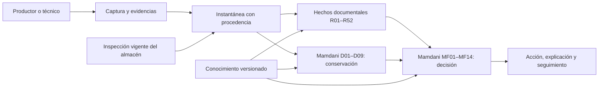

# Arquitectura del sistema de inferencia difusa

La decisión vigente de POSCOSEGRAN procede de dos niveles Mamdani. El primero transforma mediciones de conservación en una severidad continua; el segundo combina esa salida con evidencia sanitaria, condiciones operativas, fase y plan para emitir la acción final. Los 52 criterios documentales R01–R52 alimentan hechos, cálculos, validaciones o recomendaciones. El selector de decisiones R30 permanece únicamente en el motor histórico para reproducir evaluaciones antiguas.

| Componente | Responsabilidad | Ubicación principal |
|---|---|---|
| Base de conocimiento | Parámetros documentales, conjuntos y reglas de ambos niveles; contenido inmutable por versión. | `knowledge/difuso/`, `version_conocimiento.contenido` |
| Base de hechos | Observaciones de la unidad, inspección compartida válida, contexto, solicitudes, hallazgos y episodios abiertos. Desconocido conserva su estado. | `poscosegran/inferencia/base_hechos.py`, `servicios/evaluaciones.py` |
| Cálculo documental | Reglas R01–R52, límites exactos, plazos y comprobación de evidencia. Prepara antecedentes sin seleccionar la decisión nueva. | `poscosegran/inferencia/motor.py`, `lenguaje.py`, `calculos.py` |
| Inferencia difusa | Pertenencias, activaciones MIN/MAX, recorte, agregación, centroide exacto y clasificación de la acción. | `poscosegran/sistema_difuso/` |
| Explicación | Conserva observaciones, reglas disparadas, pertenencias, curvas, centroide, fuentes y motivos. | `poscosegran/inferencia/explicacion.py`, `src/components/DecisionMamdani.tsx` |
| Adquisición | Propuesta, validación, simulación de impacto y activación versionada del conocimiento. | `poscosegran/inferencia/adquisicion.py`, `api/rutas/adquisicion.py` |
| Motor histórico | Reproduce resultados de las bases sin decisión Mamdani final. | `poscosegran/sistema_experto/motor.py` |

El algoritmo central se puede seguir en `sistema_difuso/motor.py` → `sistema_difuso/decision.py` → `pertenencia.py`, `reglas.py` y `defuzzificacion.py`. Los antecedentes exactos, incluidos moho o cuarentena abierta, forman parte de las reglas declaradas en `knowledge/difuso/base_conocimiento.yaml`. No hay una reasignación de la acción después del centroide. La validación de `sistema_difuso/validacion_decision.py` rechaza modelos que permitan compensar condiciones críticas.

La base PostgreSQL conserva la versión, la instantánea efectiva, la traza y las incidencias para consultar resultados históricos. Una inspección compartida se limita a trece campos de infraestructura e higiene; requiere fecha, evidencia, revisión vigente y ausencia de evento invalidante para esa unidad. Datos del grano, contaminación y episodios jamás se copian desde otro lote. Los permisos del productor, técnico, administrador e ingeniero separan operación, asignación de acceso y mantenimiento del modelo.

Las funciones de pertenencia, reglas completas y fundamento se detallan en [CONVERSION_DIFUSA.md](CONVERSION_DIFUSA.md). La [arquitectura experta original](archivo/ARQUITECTURA_SE_2_0.md) está archivada como referencia histórica.
